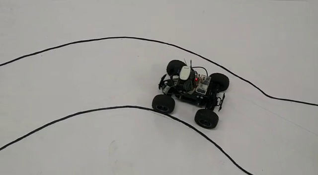

# Car Behavioural Cloning

This repository contains the code for an **honours project** on vision-based
behavioural cloning for a physical RC car. It provides a small, reproducible
CNN-regression example for learning continuous driving-control targets from
preprocessed grayscale car images.

The robot combines a forward-facing camera, a Raspberry Pi-based control
system and a line-following track. The prepared dataset uses 6,627
Canny-preprocessed `64 x 64` images, with two continuous outputs that represent
the original driving controls.

## Project video

[Watch the behavioural-cloning honours project showcase](https://drive.google.com/file/d/1MTzskjVxMeXpl2r-PrD8J5mpxSEIIMxa/view?usp=sharing)

The video shows the physical track, the real Canny training examples, the CNN
architecture and the original thesis experiments. It also distinguishes the
historical honours-project results from the cleaned, reproducible PyTorch
trainer in this repository.

### Showcase highlights

- 6,627 prepared camera/control pairs with a single-channel `64 x 64` input.
- A compact CNN regressor predicting two continuous control values.
- Historical experiments covering model comparisons, training-set size and
  CPU/GPU training.
- A reported 92.5% result on unseen image data and a physical Raspberry
  Pi-based RC-car prototype.
- A physical demonstration described by the original project as partial:
  autonomous steering was learned, while speed remained constant.

## Vehicle and operation

<table>
  <tr>
    <td align="center">
      
      <br><em>Onboard camera and control hardware</em>
    </td>
    <td align="center">
      
      <br><em>RC car following the track during operation</em>
    </td>
  </tr>
</table>

## Dataset

`data/Canny_Preprocess.mat` contains:

- `X`: 6,627 single-channel images in MATLAB order `(64, 64, 1, samples)`.
- `y`: two continuous target values per image in `(samples, 2)`.

The target values are kept as generic `control_1` and `control_2` because the
available files do not document their units or mapping to vehicle controls.
The targets in this file match the first 6,627 rows of the archived
`ControlOutputs.mat`.

The model expects preprocessed images in the same representation as `X`; it
normalizes pixel values to `[0, 1]`. It uses the first 80% of samples for
training and the final 20% for validation, preserving file order. If samples
are not chronologically ordered, adjust the split strategy before interpreting
validation results.

Other `.mat` files in the original folder are excluded from this prepared
copy: some are large, alternative-resolution datasets, or have labels whose
row alignment cannot be confirmed from the available files. The original
folder remains unchanged.

## Train

Use Python 3.10 or newer:

```powershell
python -m venv .venv
.\.venv\Scripts\Activate.ps1
python -m pip install --upgrade pip
python -m pip install -r requirements.txt
python train.py
```

Training automatically uses CUDA when available and otherwise runs on CPU.
Example overrides:

```powershell
python train.py --epochs 60 --batch-size 32 --device cpu
python train.py --data PATH\TO\another_dataset.mat --output-dir runs\experiment-2
```

The output directory contains the best validation checkpoint, training and
validation curves, and a JSON metrics summary. Checkpoints are ignored by Git.

## Historical results

These plots are preserved from the previous archived run for context. They are
not the result of the new trainer above and cannot be reproduced without the
original training script and full dataset.


