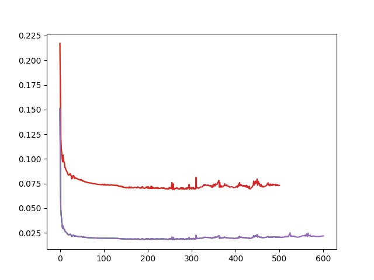
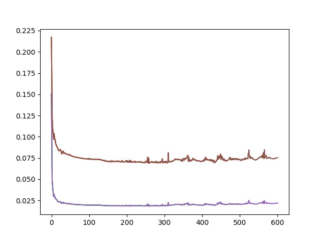

# Car Behavioural Cloning

This repository contains a small, reproducible CNN-regression example for
learning two continuous driving-control targets from preprocessed grayscale
car images. The repo uses the Canny-preprocessed dataset rather than the
unrelated SVHN digit-classification exercise also present in the source folder.

## Dataset

`data/Canny_Preprocess.mat` contains:

- `X`: 6,627 single-channel images in MATLAB order `(64, 64, 1, samples)`.
- `y`: two continuous target values per image in `(samples, 2)`.

The target values are kept as generic `control_1` and `control_2` because the
available files do not document their units or mapping to vehicle controls.
The targets in this file match the first 6,627 rows of the archived
`ControlOutputs.mat`.

The model expects preprocessed images in the same representation as `X`; it
normalizes pixel values to `[0, 1]`. It uses the first 80% of samples for
training and the final 20% for validation, preserving file order. If samples
are not chronologically ordered, adjust the split strategy before interpreting
validation results.

Other `.mat` files in the original folder are excluded from this prepared
copy: some are large, alternative-resolution datasets, or have labels whose
row alignment cannot be confirmed from the available files. The original
folder remains unchanged.

## Train

Use Python 3.10 or newer:

```powershell
python -m venv .venv
.\.venv\Scripts\Activate.ps1
python -m pip install --upgrade pip
python -m pip install -r requirements.txt
python train.py
```

Training automatically uses CUDA when available and otherwise runs on CPU.
Example overrides:

```powershell
python train.py --epochs 60 --batch-size 32 --device cpu
python train.py --data PATH\TO\another_dataset.mat --output-dir runs\experiment-2
```

The output directory contains the best validation checkpoint, training and
validation curves, and a JSON metrics summary. Checkpoints are ignored by Git.

## Historical results

These plots are preserved from the previous archived run for context. They are
not the result of the new trainer above and cannot be reproduced without the
original training script and full dataset.





## Project cleanup notes

- The source `cnn_tf2.0.py` reads the SVHN `train_32x32.mat` / `test_32x32.mat`
  files and trains a ten-class digit classifier; it does not train the car
  control data, so it is intentionally not copied here.
- The course examples and large checkpoints are omitted. The upstream course
  repository does not declare a license in its repository metadata.
- `Image_Control_Data.mat` and its separate label file are not copied because
  their row-wise label alignment differs from `ControlOutputs.mat`; the
  Canny-preprocessed file provides an unambiguous image/target pair.
- No license is declared for the project files. Choose a license before
  publishing if you want to grant reuse rights.
